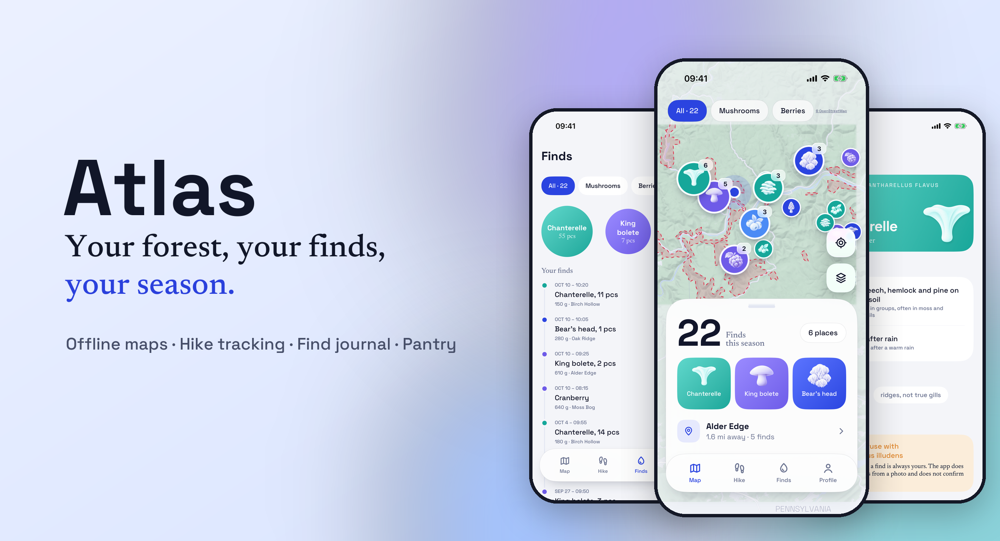
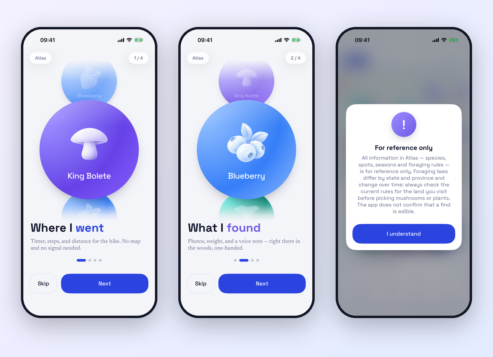
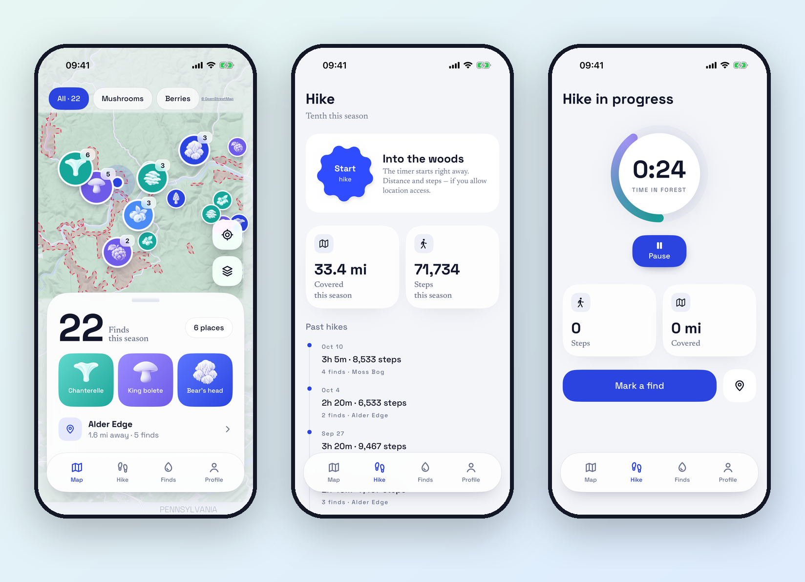
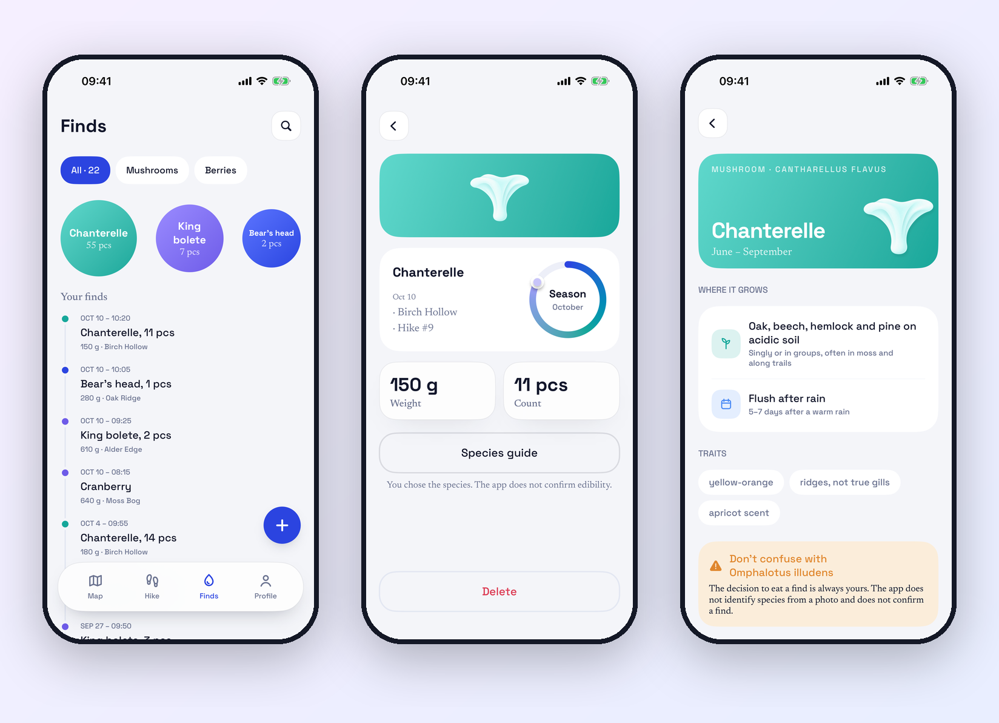
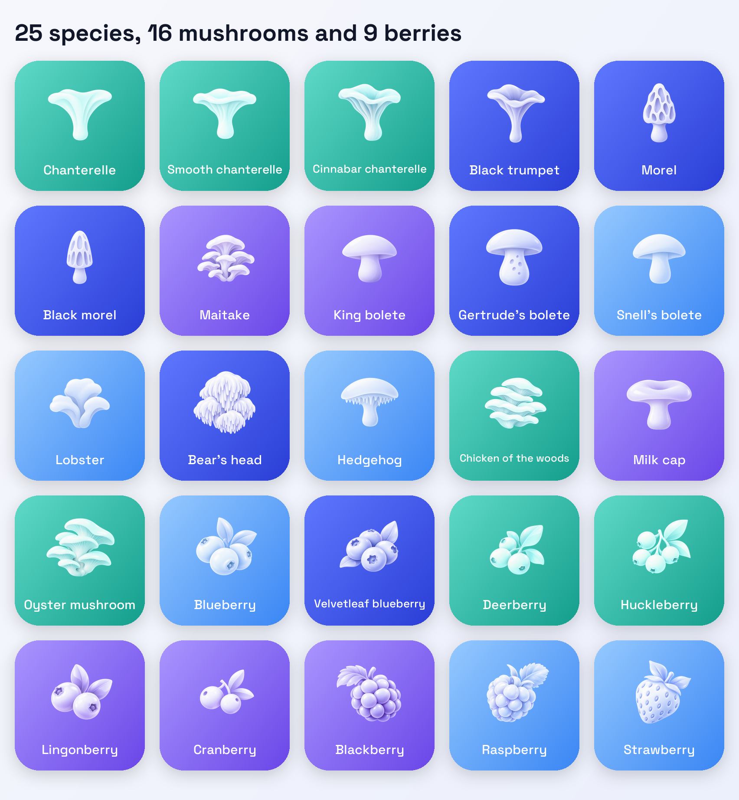
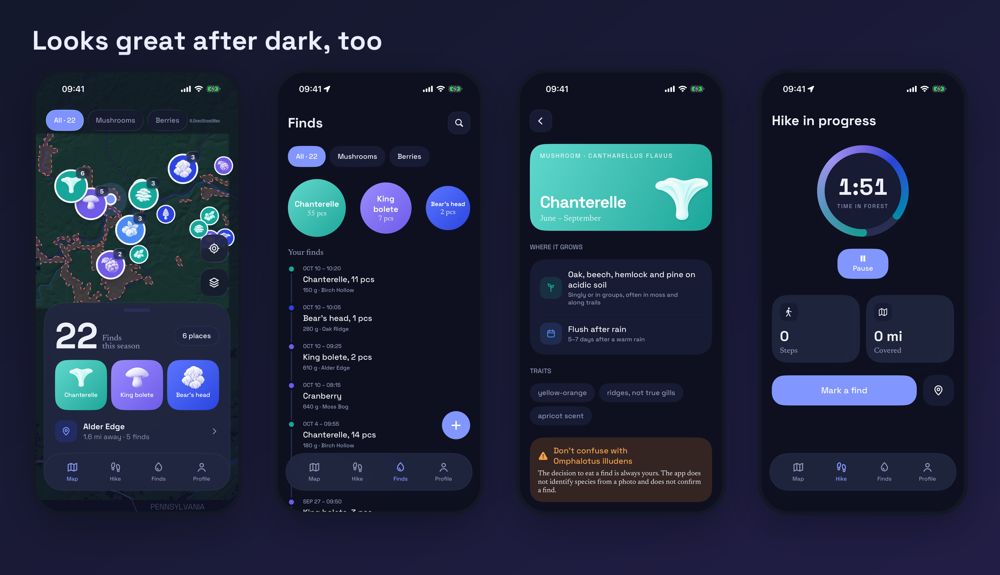

# Atlas

### The forager's field journal that works where your signal doesn't

**Offline forest maps · Hike tracking · A journal of every find · A built-in species guide**

---

## 🌲 Made for the woods

Good mushroom spots and berry patches don't come with cell coverage. Atlas is built for that. The maps, the species guide and your whole journal live on your iPhone, so everything keeps working deep in the forest, in airplane mode, miles from the nearest tower.

Head out, start a hike, and mark what you find. When you get home, it's all there: where you went and what you found.

---

## 🗺️ Offline maps of 20 forests

Atlas ships with detailed offline maps of **20 forests across Michigan, Wisconsin, Pennsylvania, Vermont, Maine and Ontario**, with terrain relief, rivers and forest boundaries, all built on OpenStreetMap data.

- **Every spot on one map.** Each place shows the species you found there and how many times. Tap it to see its whole history.
- **Mushrooms or berries.** Filter the map with one tap.
- **Your season at a glance.** Total finds, your top species and the nearest of your places, right on the map.

## 🥾 Hike tracking without the fuss

Tap **Start** and go. Atlas keeps time in the forest and counts your distance and steps, so you don't need a signal or a separate fitness app. Every hike goes into your history with its date, duration, distance and the finds you made on the way.

---

## 🍄 A journal of every find

Mark a find right where you stand, one-handed, with a basket in the other hand:

- 📸 **A photo** of the find
- ⚖️ **Weight or count**: 150 g of chanterelles, 11 pieces
- 📍 **The place**, saved automatically from your location
- 🎙️ **A voice note** about the smell, the cap colour and the nearby trees. Atlas turns it into text, on the device whenever possible.

Browse your finds by species or by date, filter mushrooms and berries, and search the whole season.

## 📖 A built-in species guide

Every species comes with a field card: **when it's in season, where it grows, when to look after rain, its key traits and the look-alikes you must not confuse it with.**

> ⚠️ **Safety first.** Atlas is a journal and a reference, not an identifier. It does not identify species from photos and does not confirm that a find is edible. Foraging rules differ by state and province, so always check the current rules for the land you visit. The decision to eat anything is always yours, so when in doubt, leave it out.

---

## 🌿 25 species to discover

From chanterelles and maitake to wild blueberries and lingonberries, every species has its own illustration and colour across the app.

---

## 🖼️ Your season in one picture

At the end of the season, save your harvest as a beautiful card to Photos and share it with friends.

## 🌙 Light or dark

Atlas looks just as good at dawn as it does after sunset. Switch to the dark theme in one tap.

---

## 🔐 Private by design

- **Your spots never leave your phone.** Finds, places, photos, voice notes, hikes and your profile are stored only on your iPhone.
- **No account needed.** Explore the map and keep your journal as a guest. Sign up only if you want to.
- **No ads.**

Read the full [Privacy Policy](https://github.com/atlasdevteam26/Atlas/blob/main/privacy-policy.md).

---

**Atlas** is made by **Compassion 365 Foundation**, a charitable foundation in Markham, Ontario, Canada.

[compassion365.ca](https://compassion365.ca) · [liam@compassion365foundation.org](mailto:liam@compassion365foundation.org)

*Map data © OpenStreetMap contributors.*

